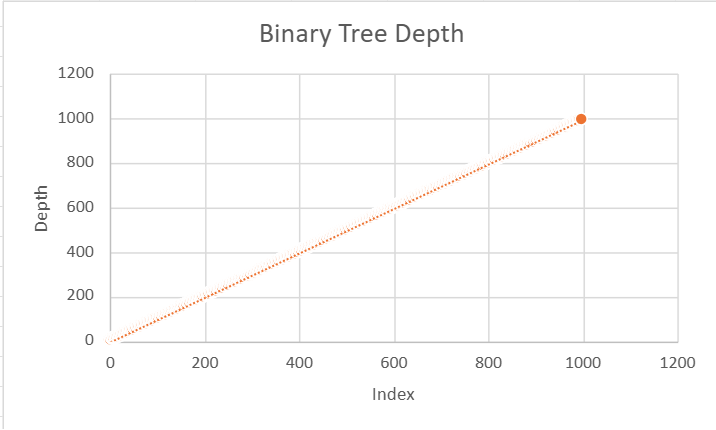
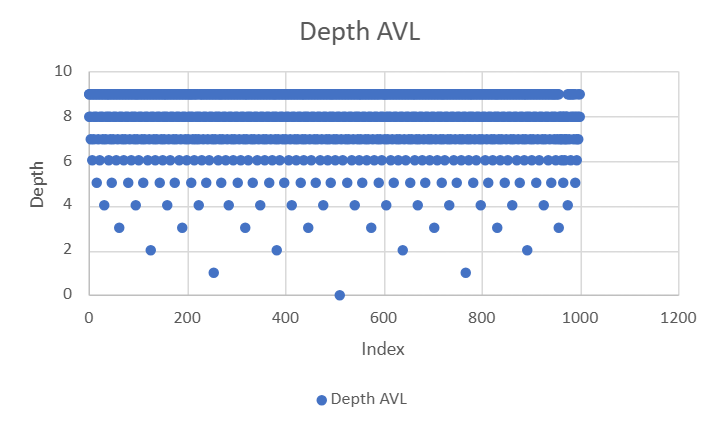
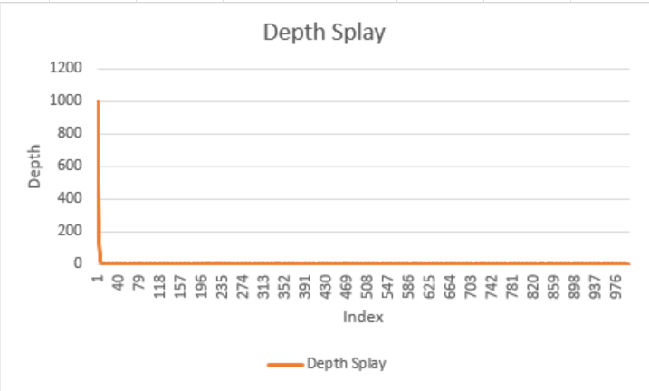

# Project 3 Report

Answer the following questions directly in this file:
* You will have a different grader again, so make sure your report includes information about your dataset.
  * My dataset is a set of all monsters from the game Dungeons and Dragons. The set contains multiple attributes from the mosnsters; name, challenge rating, type, size, armor class, hit point, movement, and alignment. Only the first five attributes are added to the object. 
  * Name- The name of the monsters.
  * Cr- Stands for Challenge Rating, it determines the difficulty level of the monster.
  * Type- The category of monster it is. ranging from humanoid like creatures to fey like creatures
  * Size- How big the creature is, it determines how much space the creature take up on a 5x5 square grid.
  * Ac- Stands for Armor Class, it represents how hard it is to hit and deal damage to the monster. The higher the AC the harder it is to hit.
  * (Unused data explained below)
  * Hp- Stands for Hit Points, it is how much healh a monster has and in combat is what players are trying to get down to zero.
  * Movement- It says whether or not the monster has special movement abilities like if it can swim or climb.
  * Alignment- It is the behavior of the monster, a lawful good alignment means that the creature will follow a set of laws to do good deeds while a chaotic evil will do whatever evil acts they wish.

* How do the depths of the random-ordered integers compare to the depths of the ordered integers for each tree? Why?
  * In a binary tree an unsorted list of integers is going to have the root the first randomized integer in the list and any integer smaller is going to the left of that root with the smaller the integer the deeper the depth while on the right side the depth gets larger, the larger the integer is. In a sorted integer list every integer will be to the right of the root as the first integer added is the smallest integer, so each added integer will have a depth one more than the previous integer as each integer added will always go on the right due to the ordered nature of the list.
  * In an AVL tree an unsorted list of integers is going to have depths similar to an unsorted list added to a binary tree however due to AVL balancing the tree the smallest integer will have a depth of at least 1 away from the highest integer. With a sorted integer list due to the AVL balancing the tree it will result in the same tree produced with an unsorted list
  * In a Splay tree an unsorted list is going to be sorted similarly to the AVL tree with the sorting and balancing aspect 
* How do the depths of each custom-data-type tree compare to each other?
  * The custom data type in the Binary Tree has depths in order as to when they were added as the list of items is in alphabetical order and the items are compared by their names.
  * The custom data types in the AVL Tree have depths based on their name as they get added in alphabetical order. the farther they are down in the alphabet the deeper they are in the tree.
  * The custom data types in the Splay Tree have depths where the objects added first are lower down on the tree as they are not referenced as often when sorting the list due to the list being already sorted alphabetically.
* Why do the depths of the second custom-data-type Splay Tree make sense?
  * They make sense as the balancing of play trees means that the objects least referenced would be at the lowest point in the splay tree as they are no longer needed to reference to find the place of the next object addded to the tree.
* Graph the Binary Search Tree, AVL Tree, and Splay Tree depths for the custom data type trees. Do not use C++ to graph, you can use whatever spreadsheet application or graphical programming language you prefer. You can use whatever graph is most readable to you (e.g. scatter plot, histogram, etc.).
  * 
  * 
  * 
* Compare and contrast the graphs and explain the differences based on what you know about the structure and behavior of the trees. Justify the time complexity of searching the trees based on the results.
  * In the Binary tree graph is a diagonal line that shows the time complexity of the worst case as a binary tree with a sorted list works in its worst state. This is Linear time complexity as the ordered addition to the tree means that each point has to be checked before adding the next object.
  * In the ALV tree graph it shows the formation of the tree and how it is balanced. The balancing of the AVL tree means that the time complexity is logarithmic because when adding a new leaf it has to check for balance and readjust the tree as required.
  * In the Splay tree graph we see how the graph follows a logarithmic form. The time complexity is logarithmic for similar reasons as to the AVL tree from the balancing as needed. 
  * The depth is able to reflect the time complexity of the graphs as time complexity is affected by the objects getting added to trees and how each tree add objects and if they balance their nodes.
**Note: Any code that was not authored by yourself or the instructor must be cited in your report. This includes the use of concepts not taught in lecture.**