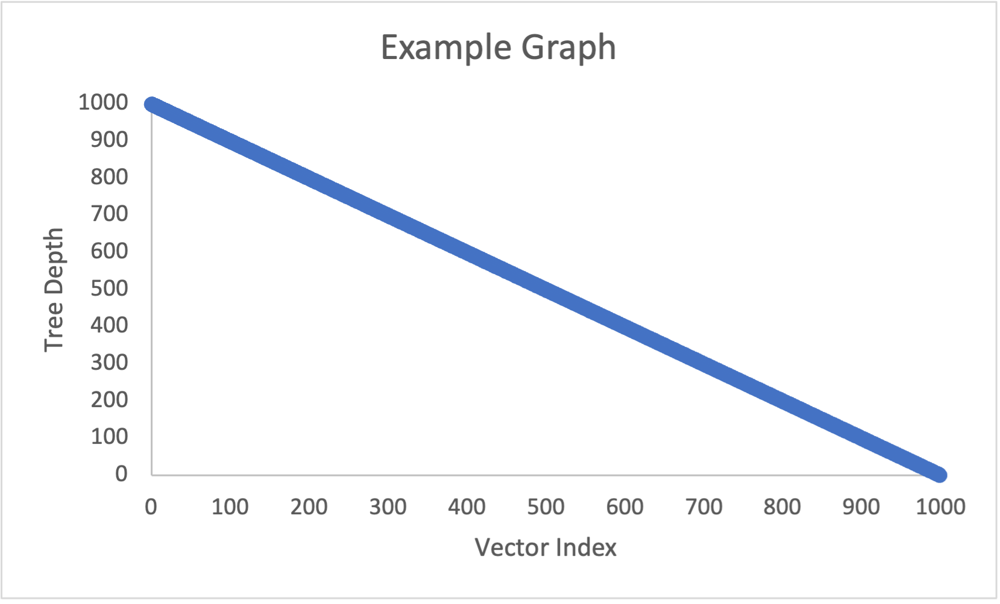

# Project 3 Report

Answer the following questions directly in this file:
* You will have a different grader again, so make sure your report includes information about your dataset.
  * My dataset is a set of all monsters from the game Dungeons and Dragons. The set contains multiple attributes from the mosnsters; name, challenge rating, type, size, armor class, hit point, movement, and alignment. Only the first five attributes are added to the object. 
  * Name- The name of the monsters.
  * Cr- Stands for Challenge Rating, it determines the difficulty level of the monster.
  * Type- The category of monster it is. ranging from humanoid like creatures to fey like creatures
  * Size- How big the creature is, it determines how much space the creature take up on a 5x5 square grid.
  * Ac- Stands for Armor Class, it represents how hard it is to hit and deal damage to the monster. The higher the AC the harder it is to hit.
  * (Unused data explained below)
  * Hp- Stands for Hit Points, it is how much healh a monster has and in combat is what players are trying to get down to zero.
  * Movement- It says whether or not the monster has special movement abilities like if it can swim or climb.
  * Alignment- It is the behavior of the monster, a lawful good alignment means that the creature will follow a set of laws to do good deeds while a chaotic evil will do whatever evil acts they wish.

* How do the depths of the random-ordered integers compare to the depths of the ordered integers for each tree? Why?
  * In a binary tree an unsorted list of integers is going to have depths unrelated to the size of the integer while in an ordered list the higher the depth the higher the integer will be at that depth.
  * In an AVL tree  
* How do the depths of each custom-data-type tree compare to each other?
  * The custom data types have depths based on their name as they get added in alphabetical order. 
* Why do the depths of the second custom-data-type Splay Tree make sense?
  * 
* Graph the Binary Search Tree, AVL Tree, and Splay Tree depths for the custom data type trees. Do not use C++ to graph, you can use whatever spreadsheet application or graphical programming language you prefer. You can use whatever graph is most readable to you (e.g. scatter plot, histogram, etc.).
  * Your graphs should have clear labels for both x and y axes.
  * Save your graph files in the graphs folder.
  * You do not need to graph the depths of the integer type trees or the Splay Tree that finds each object 5 times in a row, but you can if you feel it helps you analyze the data.
  * An example graph spreadsheet and an example graph image have been included in the starter code.
  * Here is how you include an image in your Report.md file: 
* Compare and contrast the graphs and explain the differences based on what you know about the structure and behavior of the trees. Justify the time complexity of searching the trees based on the results.

**Note: Any code that was not authored by yourself or the instructor must be cited in your report. This includes the use of concepts not taught in lecture.**